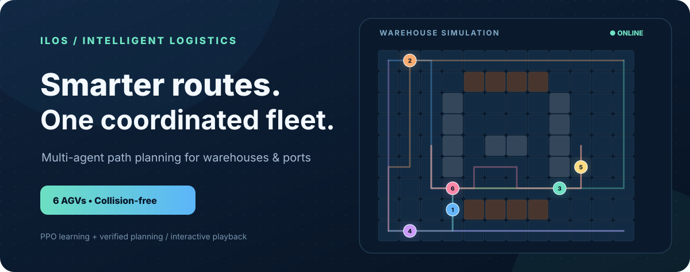
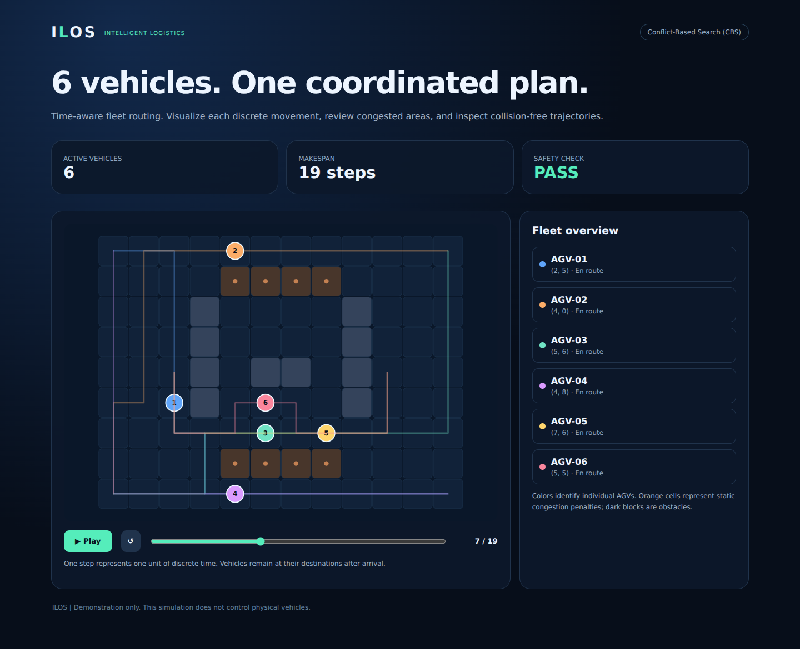
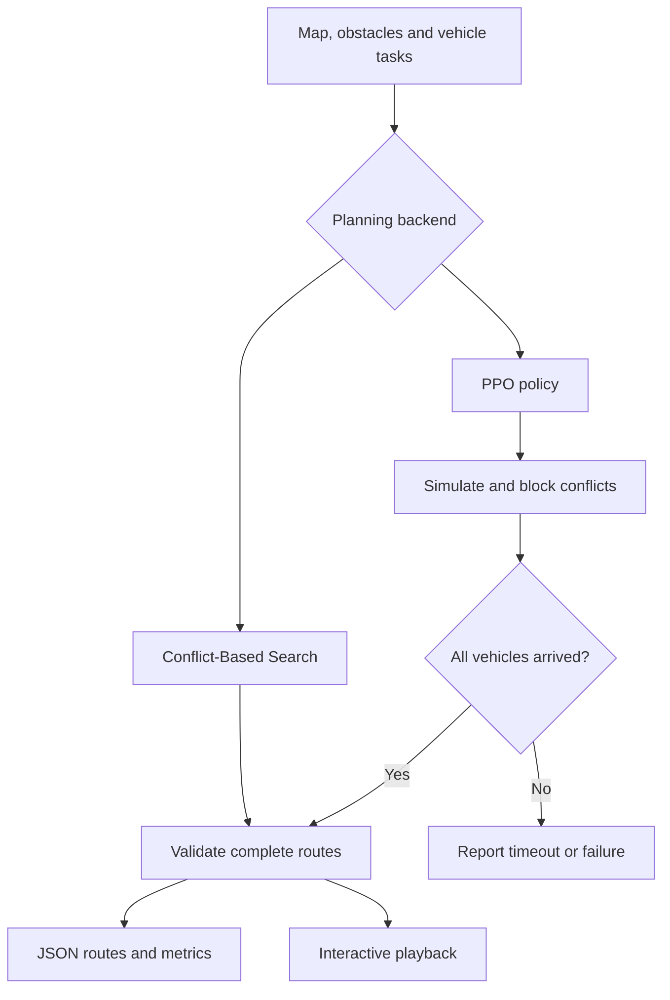

<div align="center">



# ILOS

**Intelligent Logistics Optimization System**

Coordinated routes for warehouse and port vehicles. Learn a policy, inspect its
movements, and replay every step.

[](https://github.com/halimtayeb47/ILOS/actions/workflows/ci.yml)


[Quick start](#quick-start) · [Modern version](modern/README.md) · [Huawei version](huawei/README.md) · [Contributors](CONTRIBUTORS.md)

</div>

## One map. A coordinated fleet.

Planning the shortest route for each vehicle separately can create collisions at
intersections and head-on conflicts in narrow aisles. ILOS coordinates where
vehicles move **and when they move**.

The modern version combines a **PPO learning backend**, a **Conflict-Based Search
(CBS) planner**, a collision-aware simulator and an offline route visualizer.
The Huawei work lives in its own folder, with recovered source, the original
PyTorch checkpoint and a new MindSpore compatibility backend.

ILOS was originally developed for the **Huawei ICT Competition**.



*The actual six-vehicle demo at step 7. Open the generated HTML to play, pause,
restart or inspect any time step.*

## Quick start

**Python 3.10+. No GPU, account or API key needed for the CBS demo.**

```bash
git clone https://github.com/halimtayeb47/ILOS.git
cd ILOS
python -m pip install -e ./modern
ilos modern/examples/six_vehicles.json --html outputs/demo.html
```

Open **`outputs/demo.html`** in your browser. The same commands work in Windows
PowerShell, macOS and Linux. If the `ilos` command is not on PATH, use
`python -m ilos` in its place. Prefer a fresh virtual environment for installation.

### Try the trained PPO model

```bash
python -m pip install -e './modern[learning]'
ilos modern/examples/three_vehicles.json --backend ppo --model modern/checkpoints/port_ppo.zip --html outputs/ppo.html
```

This is a real, trained neural policy for the included three-vehicle port map.
Its checkpoint and training metadata are included. See the
[model card](modern/checkpoints/README.md) for the exact scope and results.

## Two implementations, clearly separated

| | Modern | Huawei / recovered baseline |
| --- | --- | --- |
| Folder | [`modern/`](modern/README.md) | [`huawei/`](huawei/README.md) |
| Learning model | PPO actor–critic | DQN |
| Framework | PyTorch + Stable-Baselines3 | Recovered PyTorch source + new MindSpore port |
| Action output | Five choices per vehicle | One Q value per joint action combination |
| Included model | Trained three-vehicle PPO | Original final DQN checkpoint |
| Routing alternative | CBS + space-time A*, no training | Historical simulator and edge API |
| Visualization | Interactive offline playback | Legacy text rendering |

For six vehicles, the old joint-action network would need **15,625 Q outputs**;
the PPO policy uses **30 action logits**. This reduces output-layer growth but
is not proof of better performance on every map. The shared collision blocking
and independent route validation provide checks beyond the learned policy.

## How it works



- **Coordinate:** move, wait and account for occupied destinations.
- **Check:** reject same-cell collisions, head-on swaps and blocked paths.
- **Inspect:** view each vehicle's route, current position and arrival time.
- **Integrate:** send a scenario to the optional local FastAPI service.
- **Reproduce:** run the included scenarios, checkpoints and automated tests.

## Measured examples

| Run | Goals reached | Completion | Route check |
| --- | ---: | ---: | --- |
| Recovered DQN, original three-vehicle map | 0 / 3 | Timed out at 60 steps | Conflict detected |
| Trained PPO, same map | 3 / 3 | 14 steps | Passed; no conflict proposals |
| CBS, same map | 3 / 3 | 14 steps | Passed |
| CBS, six-vehicle warehouse | 6 / 6 | 19 steps | Passed |

[Result files](docs/results/) contain the actual routes and evaluation outputs.
The [baseline script](scripts/evaluate_baselines.py) reproduces the DQN runs.
These are fixed-scenario demonstrations. PPO was evaluated on its training map;
training budgets and simulator dynamics differ from the recovered DQN, so this
is not a controlled algorithm benchmark or a generalization claim.

## Explore the repository

| Path | Purpose |
| --- | --- |
| [`modern/ilos/`](modern/ilos/) | Planner, PPO, simulator, CLI, API and visualizer |
| [`modern/examples/`](modern/examples/) | Six-vehicle warehouse and three-vehicle port maps |
| [`modern/checkpoints/`](modern/checkpoints/) | Trained PPO policy, metadata and model card |
| [`huawei/legacy/`](huawei/legacy/) | Recovered simulator, DQN and integration code |
| [`huawei/mindspore_backend/`](huawei/mindspore_backend/) | MindSpore training, inference and conversion |
| [`docs/demo.html`](docs/demo.html) | Self-contained six-vehicle playback; download to open |
| [`docs/ppo-demo.html`](docs/ppo-demo.html) | Playback of the trained PPO policy |
| [`.github/workflows/ci.yml`](.github/workflows/ci.yml) | Linux, Windows and separate MindSpore checks |

## Development

```bash
python -m pip install -e './modern[test,api,learning]'
python -m pytest modern/tests -q
python -m uvicorn ilos.api:app --host 127.0.0.1 --port 8000
```

API documentation is at `http://127.0.0.1:8000/docs`. See the
[modern guide](modern/README.md) for custom maps, training and API configuration,
and the [Huawei guide](huawei/README.md) for source provenance and runtime status.

This project models discrete grid movement. It does not control physical robots
or include real camera recognition or AR. An open-source license has not been
selected; public visibility alone does not grant redistribution rights.

[Contributing](CONTRIBUTING.md) · [Security](SECURITY.md) · [Contributors](CONTRIBUTORS.md)
